# Diagnóstico de calaire-app: UI/UX, gestión documental y arquitectura

- **Fecha:** 2026-11-18
- **Alcance:** perfil administrador/coordinador (la vista de participante no se pudo revisar en vivo) y arquitectura del código (`src/server`, `convex/`, almacenamiento de archivos).
- **Capturas:** `docs/screenshots/diagnostico/`, tomadas el 2026-11-18 en producción.
- **Método:**
  - Auditoría estática del código (`src/`, `convex/`), incluida la organización por capas y el almacenamiento.
  - Recorrido en producción (`https://calaire-app.vercel.app`) en escritorio (1440 px) y móvil (390 px). Solo navegación: no se envió ningún formulario ni se ejecutaron acciones que cambien datos.
  - Rondas revisadas: EA-PP2026-R3 (`kd763crwy2e9948jdvknmmhnzn88hsxv`) y EA-PP-R3 (`kd7fd3pawt3wpnvy6xe6yzwrm58any1z`).

---

## 1. Resumen ejecutivo

| Área | Estado | Comentario |
|---|---|---|
| Identidad visual y tokens | 🟢 Bueno | Paleta institucional coherente, tokens en `globals.css`. |
| Navegación y estructura | 🟠 Mejorable | Tres cabeceras apiladas (~310 px) antes del contenido. |
| Responsive / móvil | 🔴 No funcional | Las 15 pantallas revisadas desbordan horizontalmente a 390 px. |
| Captura de datos PT | 🔴 Riesgo de datos | Inputs que truncan valores, `type="number"` sin coma decimal ni protección contra la rueda del mouse. |
| Accesibilidad | 🟠 Irregular | Contrastes por debajo de AA, celdas sin etiqueta, errores solo en tooltip. |
| Consistencia de información | 🟠 Contradicciones | Estados e indicadores distintos para la misma ronda según la pantalla. |
| Arquitectura del código | 🟠 Sobrecargada | `src/server` replica a Convex en fachadas monolíticas con código duplicado; los archivos se reparten entre Convex Storage y Drive. |
| **Gestión documental de ronda (SGC)** | 🔴 **No funcional de punta a punta** | El expediente no está sincronizado con el catálogo, F-PSEA-19/20/21 no son accesibles, el Drive de la ronda no está creado y los datos de la app no alimentan los documentos. |

**Calificación UI/UX general: 6/10.** La base es sólida, pero la experiencia en móvil, la captura de datos y el flujo documental requieren trabajo prioritario.

---

## 2. Gestión documental de la ronda (foco principal)

### 2.1 Flujo esperado

Según `workflow_documentos_sgc.md` y `plan_documentos_sgc.md`, la app debe permitir:

- **F-PSEA-19 (acta de inicio):** `no_inicializado → borrador → docx_generado → pdf_firmado_cargado → publicado`.
- **F-PSEA-20 (rotulado anónimo):** `sin_archivo → archivo_cargado → usado_en_ronda`. Es interno.
- **F-PSEA-21 (instrumentos Calaire):** `borrador → pendiente_validacion → validado / requiere_ajustes`, con dos fotos por instrumento. Es interno.
- **Expediente Drive por ronda:** 8 carpetas por etapa, con enlace editable, versión definitiva, estado y visibilidad por documento.
- **Checklist de cierre:** distingue bloqueantes, críticos no bloqueantes y advertencias.
- **Portal del participante:** muestra I-PSEA-02, calendario, cronograma y F-PSEA-19 publicados.

### 2.2 Estado observado

En la ronda EA-PP2026-R3, que operativamente está terminada (envíos PT completos y lista para exportar), el checklist marca **12 %, con 34 bloqueantes y 3 críticos no bloqueantes**.

### 2.3 Bloqueantes 🔴

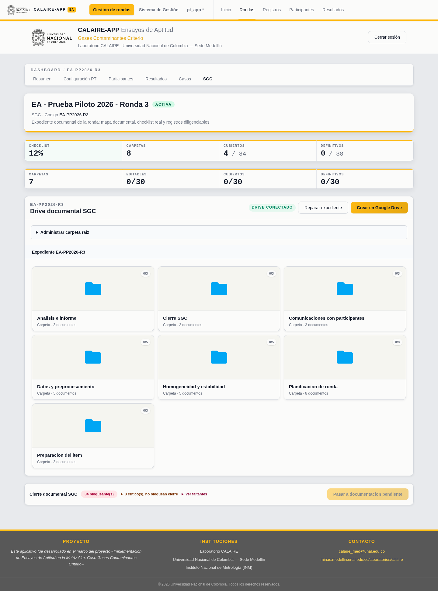

1. **El expediente está desincronizado del catálogo.**

   | | Catálogo | Expediente |
   |---|---|---|
   | Carpetas | 8 | 7 |
   | Documentos | 34–38 | 30 |

   - La pantalla muestra dos filas de indicadores contradictorias, una debajo de la otra, sin explicación.
   - Falta la carpeta `02A_inicio_ronda` (F-PSEA-19), y en Preparación faltan F-PSEA-20 y F-PSEA-21. Pasa lo mismo en la ronda más reciente.
   - Probablemente "Reparar expediente" lo resuelve, pero la interfaz no lo indica.
   - Referencias: `convex/_lib/sgc/catalog.ts:261`, `src/server/sgc/catalog.ts:260`.

2. **F-PSEA-19 y F-PSEA-21 no tienen ruta de acceso.**
   - Las páginas `…/sgc/f-psea-19` y `…/sgc/f-psea-21` existen y cargan.
   - Los botones "Gestionar acta" y "Gestionar instrumentos" solo aparecen al seleccionar ese documento en el expediente (`DriveDocumentalSgc.tsx:435-436`). Como el documento no está en el expediente, solo se llega escribiendo la URL.

3. **Drive aparece conectado, pero la ronda no tiene carpeta.**
   - La insignia dice "DRIVE CONECTADO" y "Administrar carpeta raíz" muestra "Sin folderId registrado".
   - Todos los pendientes de tipo "falta enlace editable" quedan sin forma de resolverse.
   - "Crear en Google Drive" es el botón principal y no explica qué crea.

4. **Los datos de la app no alimentan los documentos.**
   - F-PSEA-01 (Calendario) pide un enlace a un XLSX externo, aunque la app tiene calendario de hitos (`/calendario`, ICS).
   - F-PSEA-03 y F-PSEA-05 piden marcar "Diligenciado" a mano, aunque la app ya tiene fichas enviadas y cupos reclamados.
   - F-PSEA-04 ("Equipos exportados desde F-PSEA-03") pide un enlace y no hay exportación disponible.
   - Resultado: se pide duplicar en Drive información que la app ya tiene.

5. **El instructivo del participante (I-PSEA-02) aparece como "recurso Drive faltante"**, así que no hay nada que publicar al participante.

### 2.4 Fricción 🟠

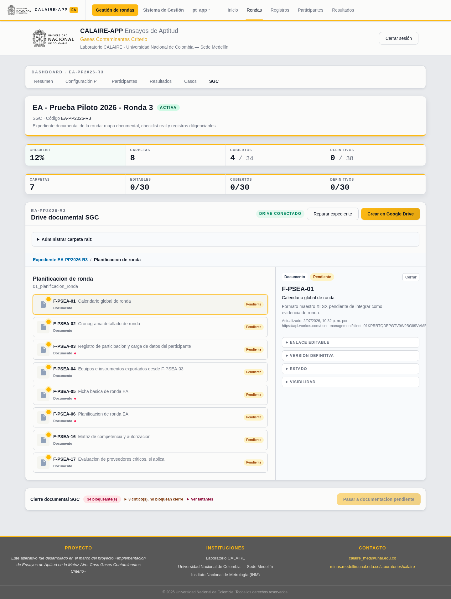

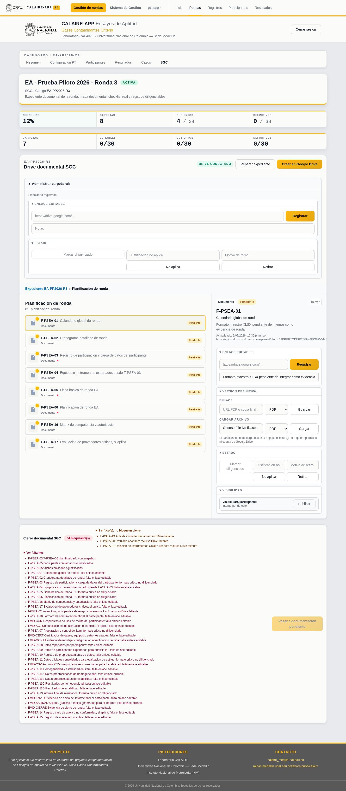

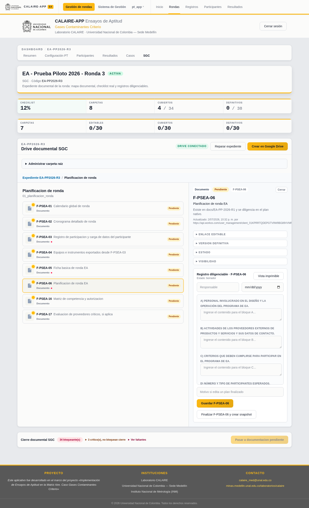

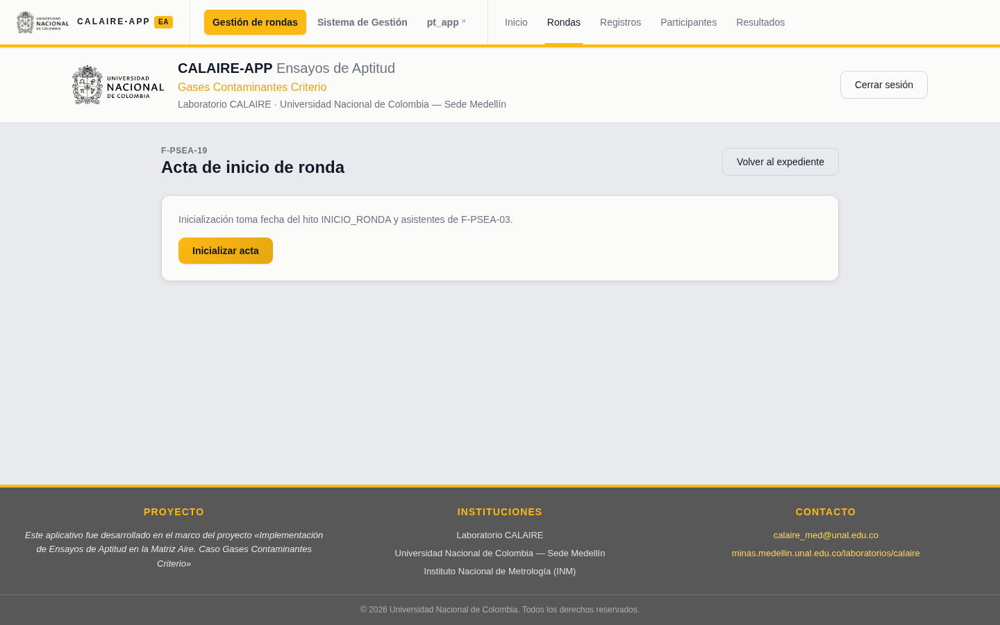

6. **Las acciones están ocultas.** El panel de cada documento esconde lo que hay que hacer en 4 acordeones (Enlace editable, Versión definitiva, Estado, Visibilidad), sin indicar el siguiente paso.
7. **Hay conceptos ambiguos.** "Diligenciado", "Enlace editable", "Versión definitiva", "Publicar", "Cubierto" y "Definitivo" no se explican. Los puntos rojo y amarillo de la lista no tienen leyenda.
8. **F-PSEA-06 se diligencia en un panel lateral estrecho** (~380 px) con scroll interno, 21 bloques de texto (a–u) y fecha en formato `mm/dd/yyyy`. Usa términos técnicos: "Finalizar y crear snapshot".
9. **Se muestran textos internos al usuario:**
   - "Actualizado por `https://api.workos.com/user_management/client_01KP…`" en lugar del nombre de la persona.
   - "Existe en docs/EA-PP-2026-R1…" mostrado en la ronda R3.
   - "Formato maestro XLSX pendiente de integrar".
10. **El acta F-PSEA-19 no guía al usuario.**
    - Solo muestra el botón "Inicializar acta".
    - Si el hito `INICIO_RONDA` no tiene fecha, el error aparece después del clic (`convex/sgc/actaInicio.ts:59`).
    - No muestra un indicador de pasos borrador → DOCX → PDF firmado → publicado.
11. **Las carpetas están en orden alfabético** y no en el orden del proceso. Les faltan tildes: "Planificacion", "Preparacion", "Analisis".
12. **El cierre es confuso.**
    - El botón "Pasar a documentación pendiente" está deshabilitado sin explicación.
    - Bloqueantes y críticos no bloqueantes tienen el mismo peso visual.

### 2.5 Lo que funciona 🟢

- "Ver faltantes" es preciso: una línea por documento con su motivo.
- La estructura de carpetas sigue los procedimientos.
- Los registros nativos (F-PSEA-06 y F-PSEA-13) tienen vista imprimible.
- La app impide publicar documentos internos (F-PSEA-20 y F-PSEA-21) (`convex/sgc/drive.ts:738`).
- Se explica que el participante descarga los documentos desde la app sin necesitar una cuenta de Drive.

### 2.6 Recomendaciones

1. **Sincronizar el expediente automáticamente** al abrirlo, o mostrar un aviso: "Hay N documentos nuevos en el catálogo → Actualizar expediente".
2. **Organizar la vista por etapas del proceso** en lugar de una cuadrícula de carpetas:
   - Cada documento con **una sola acción principal** según su estado (Crear en Drive → Diligenciar → Cargar definitivo → Publicar).
   - Acceso directo a "Gestionar" para F-PSEA-19 y F-PSEA-21.
3. **Generar documentos desde los datos de la app:**
   - F-PSEA-01 y 02 desde los hitos.
   - F-PSEA-03, 04 y 05 desde fichas y registros.
   - Marcarlos como cumplidos automáticamente cuando el dato existe.
4. **Un único indicador de avance por etapa**, con un cierre que explique qué falta, quién lo hace y un enlace directo a cada pendiente.
5. **F-PSEA-19 con indicador de pasos** y validación previa del hito `INICIO_RONDA`, antes de presionar el botón.
6. **Limpiar textos:** tildes, nombre del usuario en vez del identificador de WorkOS, formato de fecha `dd/mm/aaaa` y sin rutas internas.

### 2.7 Flujo de creación y expediente de cualquier ronda (2026-11-24)

**Alcance: todas las rondas.** Los hallazgos y el cambio propuesto son del funcionamiento general de la app, no de una ronda en particular. Se detectaron al crear `EA-CIL-2026` desde cero: después de inicializar el expediente aparecen las 8 carpetas, pero el coordinador no sabe por dónde seguir y tiene que dar vueltas entre pantallas. Esto confirma los puntos 7, 9 y 11 y agrega lo siguiente:

13. **Dentro de cada carpeta los documentos se ordenan por código, no por el orden en que se diligencian.** En Planificación se abre F-01/F-02 antes de tener F-06.
14. **No se indica quién llena cada documento** (coordinador, participante o la app), así que no se distingue lo que hay que hacer de lo que solo hay que esperar.
15. **F-PSEA-16/F-PSEA-17 ("si aplica") se ven y se cuentan como pendientes**, igual que los obligatorios.
16. **Lo previo al expediente queda fuera de la pantalla.** Configuración PT (niveles run/nivel y códigos), hitos e invitaciones están en otras rutas, sin nada que guíe hacia ellos.
17. **El código de réplica no se asigna al crear la ronda**, aunque `submitFinalPTForParticipante` lo exige (`convex/pt/index.ts:64`). Hay que llenarlo a mano en Configuración PT.

**Propuesta.** Esto cambia parte de cómo funciona la app, no solo la vista, y aplica a todas las rondas, nuevas y existentes:

- **Orden por flujo y pasos numerados en cada etapa.** Planificación: F-06 → F-01 → F-02 → F-05 → F-03/F-04 → F-16/F-17.
- **Etiqueta de responsable** en cada documento: **Tú**, **Participante** o **Automático**.
- **"Si aplica" separado** de los obligatorios, en gris, y fuera del cálculo de avance hasta que se marque que aplica.
- **Barra "Siguiente paso"** arriba del expediente, con el primer pendiente obligatorio y un enlace directo. Incluye los pasos que no son formatos SGC (Configuración PT, hitos, invitaciones), con estado calculado; por ejemplo, niveles PT cuadrados con `getNivelesPTDescuadres` (`convex/rondas/ptLevels.ts`).
- **Leyenda del punto crítico** y limpieza de textos (punto 9).
- **Código de réplica automático** al crear la ronda: referencia = 1 y participantes 2, 3, …, la convención de pt_app.

**Implica:**

- Agregar al catálogo `SGC_RONDA_ETAPAS`, por documento, el orden de flujo, el responsable y si es obligatorio o "si aplica". El catálogo está duplicado (ver 4.4), así que conviene unificarlo antes.
- Recalcular el avance y el checklist sin los "si aplica" inactivos.
- Que las rondas ya creadas tomen el nuevo orden y las etiquetas sin reinicializar el expediente, leyéndolos del catálogo y no de la copia guardada por ronda (relacionado con el punto 1, expediente desincronizado).
- Actualizar `I-PSEA-03` con el mapa de carpetas, etapas y pasos.

---

## 3. Diagnóstico UI/UX general

### 3.1 Crítico 🔴: calidad de datos en la captura PT

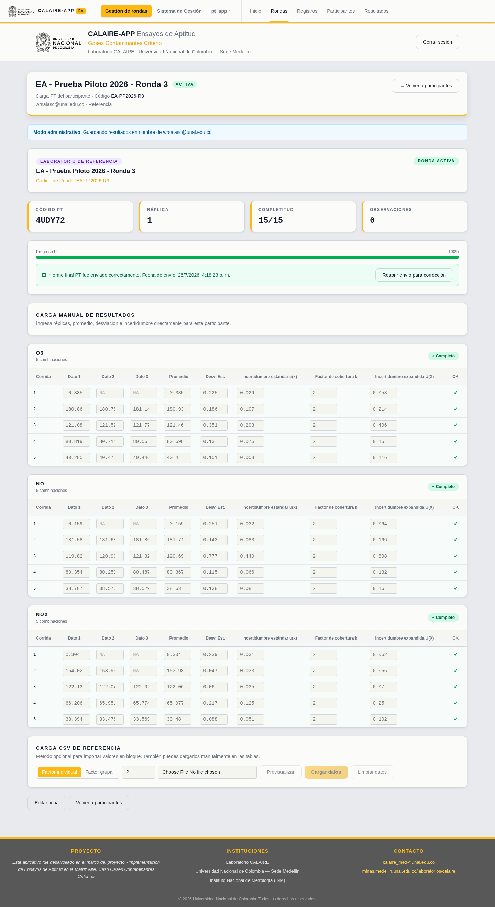

Referencia: `src/app/(protected)/ronda/[codigo]/FormularioRonda.tsx`.

1. **Los inputs truncan los valores.** Dato 1–3, Promedio y Desv. Est. son demasiado angostos: se ve `180.8` en lugar de `180.86…`. No se puede verificar lo que está guardado. La columna "Incertidumbre expandida" tiene espacio sobrante.
2. **`type="number"` (línea ~806):**
   - La rueda del mouse cambia el valor del campo que tiene el foco, y el autoguardado lo registra.
   - Rechaza la coma decimal (`12,5`), que es la usual en Colombia.
   - Usar `type="text" inputMode="decimal"` y normalizar la coma.
3. **Promedio y desviación estándar se escriben a mano** aunque Dato 1–3 ya están. Conviene calcularlos o advertir cuando no coinciden.
4. **Errores solo en tooltip** (`✗` con `title`, línea ~881). No se ven en pantallas táctiles ni con lector de pantalla. El texto "Faltan N celdas" no dice cuáles.
5. **Las celdas de la tabla no tienen `aria-label`.** En todo `src/` hay ~269 `<input>` contra ~104 etiquetas.
6. **La carga CSV queda al final**, debajo de ~45 filas. El nombre de la ronda, el estado "ACTIVA" y "Volver a participantes" aparecen duplicados.

### 3.2 Alto 🟠: navegación y estructura

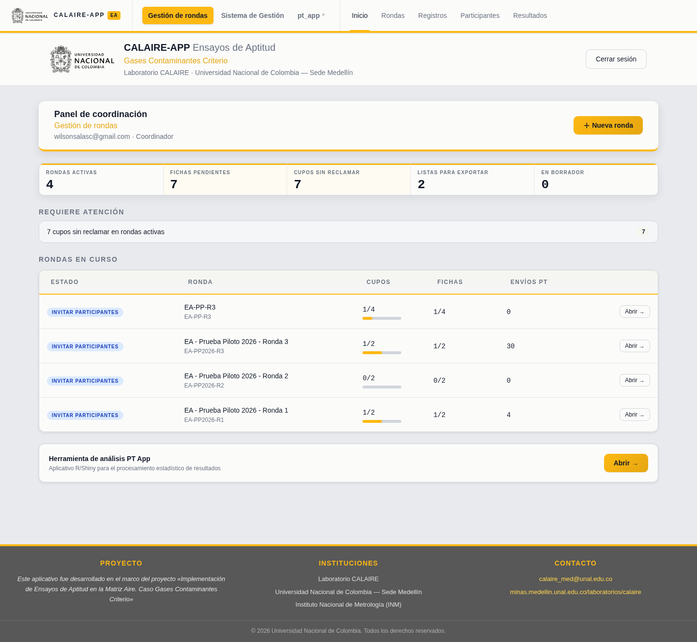

| Móvil: panel | Móvil: participantes de ronda |
|---|---|
| 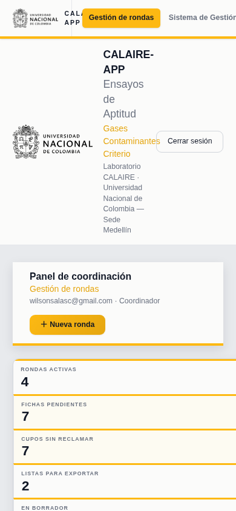 | 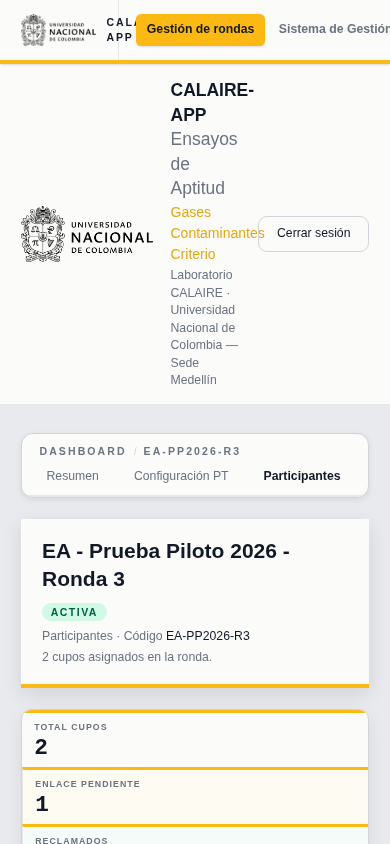 |

7. **Tres cabeceras apiladas** (barra de navegación, franja con el logo y tarjeta de la página), ~310 px antes del contenido. El logo aparece dos veces (`dashboard/SidebarNav.tsx:131-197`). Propuesta: una sola barra con menú de usuario.
8. **No hay navegación móvil.** `MobileNav()` devuelve `null`. A 390 px:
   - Todas las pantallas desbordan horizontalmente.
   - El título se parte palabra por palabra.
   - Las secciones quedan fuera de la pantalla.
9. **El participante no puede cerrar sesión** fuera de `/mi-dashboard`: el botón no está en `ParticipantTopNav`.
10. **"Inicio" siempre aparece activo** para el participante (`ParticipantTopNav.tsx:22`, `aria-current="page"` fijo), incluso en `/calendario`.
11. **El panel del participante muestra el desempeño antes que sus rondas** (`mi-dashboard/page.tsx:413`). Las tareas pendientes deberían ir primero.
12. **El enlace "pt_app"** a shinyapps está al nivel de las áreas principales, con un nombre poco descriptivo.

### 3.3 Alto 🟠: información contradictoria

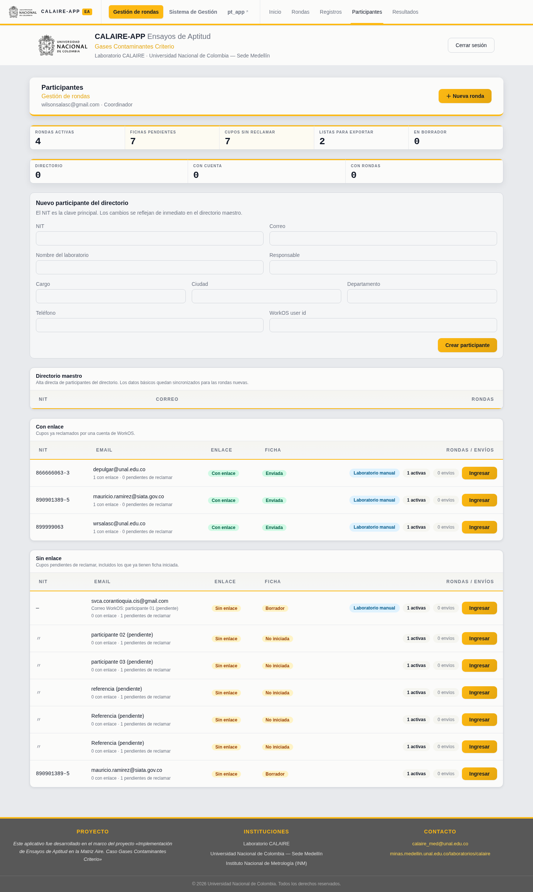

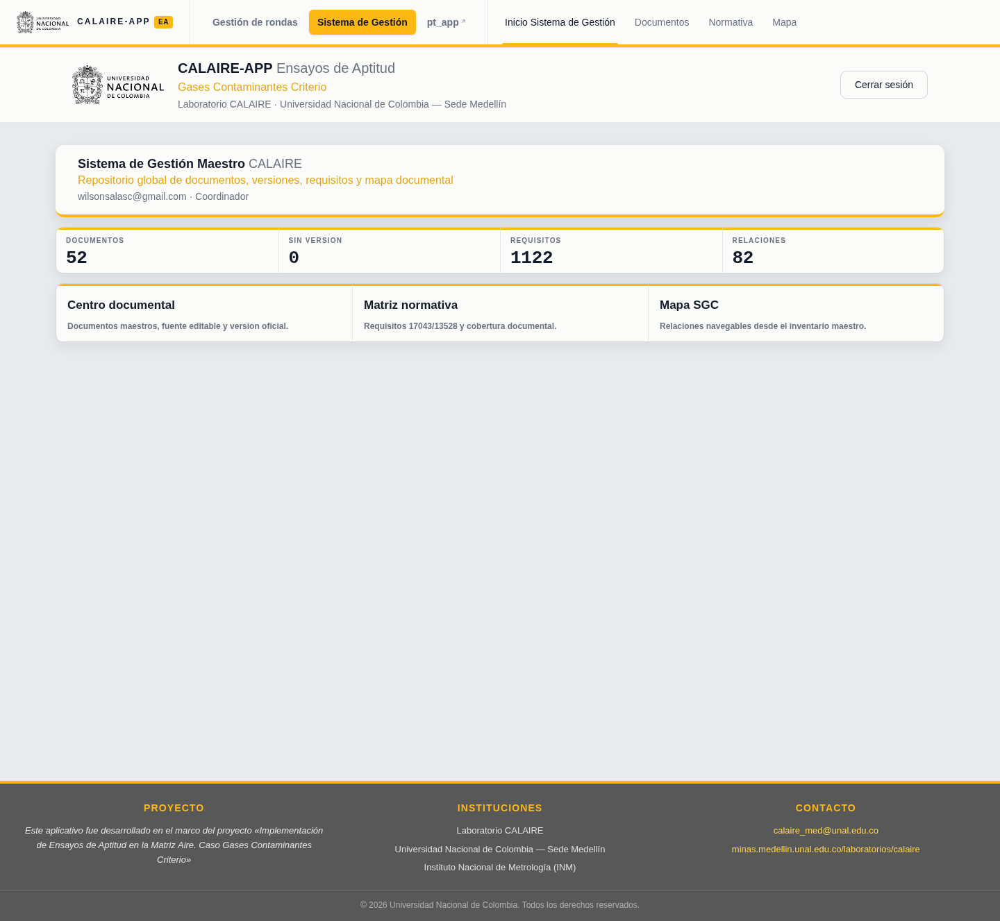

13. **El estado de una ronda varía según la pantalla.** En el panel, las 4 rondas dicen "INVITAR PARTICIPANTES". En el detalle, R3 dice "ACTIVA" y "Lista para exportar", con 30 envíos.
14. **Participantes:**
    - "Directorio maestro" muestra 0 y la tabla está vacía, aunque debajo se listan 10 cupos.
    - El mismo correo (`mauricio.ramirez@siata.gov.co`) aparece a la vez en "Con enlace" y en "Sin enlace".
15. **Avisos y tarjetas que no son enlaces:**
    - "Requiere atención: 7 cupos sin reclamar" no lleva a ninguna parte.
    - Las tarjetas Centro documental, Matriz normativa y Mapa SGC del inicio del SGC parecen botones, pero no son enlaces.

### 3.4 Medio 🟡: jerarquía, consistencia y accesibilidad

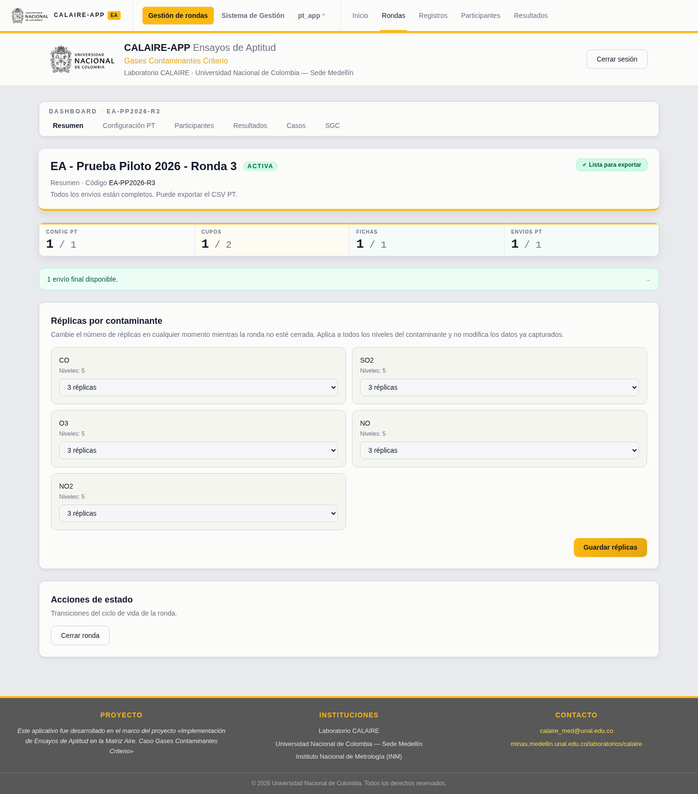

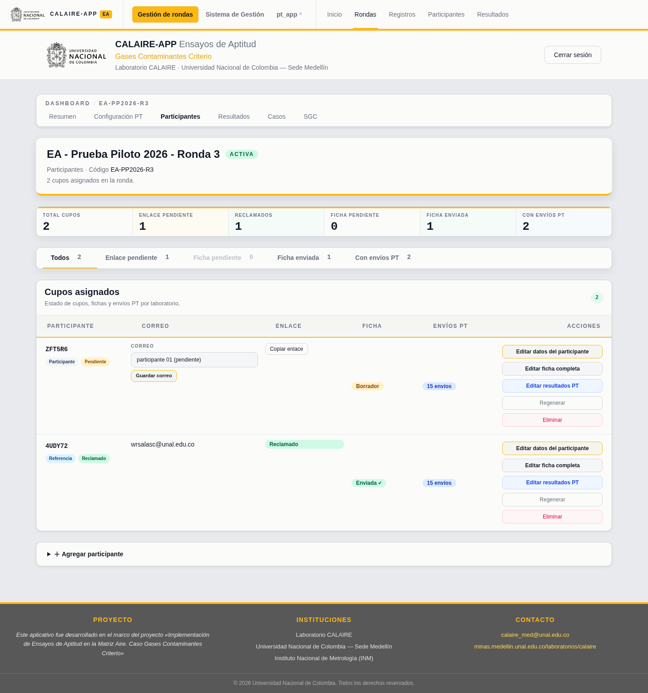

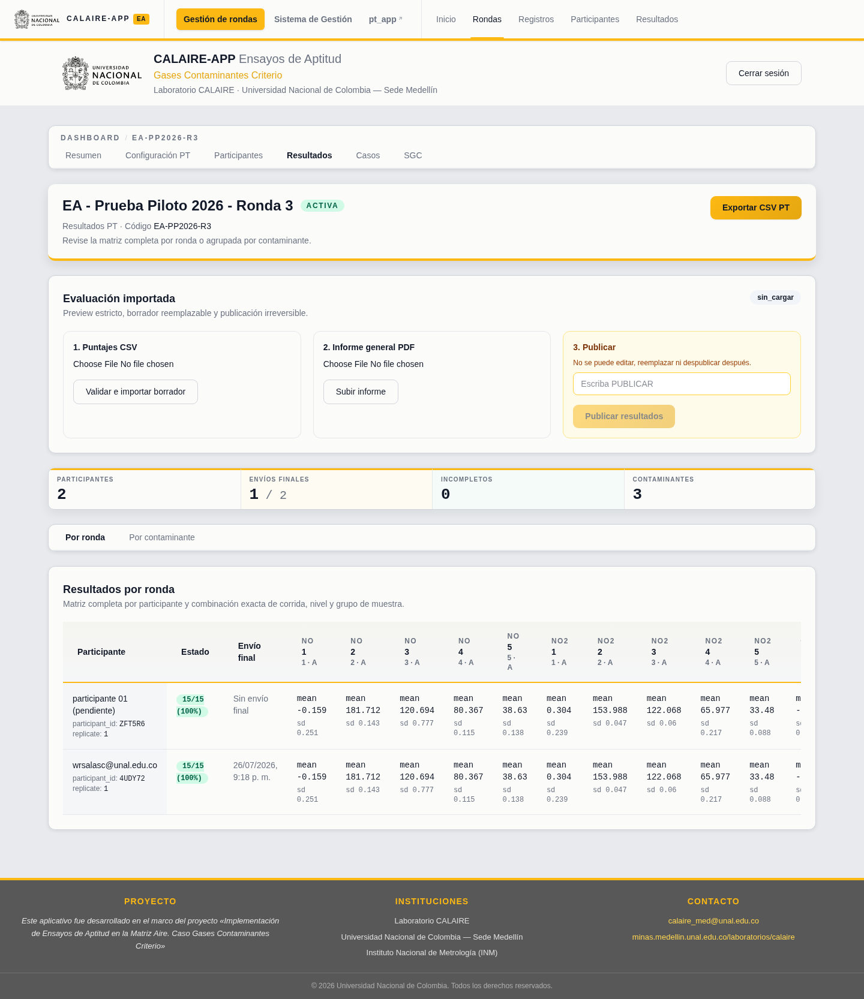

16. **Detalle de ronda:**
    - La pestaña "Resumen" en realidad es la configuración de réplicas.
    - "Cerrar ronda", una acción irreversible, aparece como botón secundario sin ninguna zona de peligro.
17. **Participantes de ronda:**
    - 5 botones apilados por fila, con "Eliminar" junto a los demás.
    - El campo de correo muestra "participante 01 (pendiente)".
18. **Participantes global:**
    - El formulario de alta está arriba y empuja la lista hacia abajo.
    - Pide "WorkOS user id", un dato técnico.
    - Repite los indicadores del panel principal.
    - Usa `〃` en lugar del NIT.
19. **Resultados:**
    - Muestra términos internos o en inglés: `sin_cargar`, "Preview estricto", `mean` / `sd`.
    - La matriz se desplaza hacia los lados sin columna fija para el participante.
20. **Contraste por debajo de WCAG AA** (se exige 4.5:1):

    | Uso | Contraste |
    |---|---|
    | Texto `--pt-primary-dark` sobre el panel (25 usos) | 2.07:1 |
    | Anillo de foco dorado | 1.67:1 |
    | `--success` como texto | 2.77:1 |
    | `--foreground-muted` sobre el fondo | 4.01:1 |

21. **Dos sistemas visuales mezclados:**
    - ~687 usos de colores Tailwind fijos (`slate`, `amber`, `emerald`…) frente a ~1229 usos de tokens.
    - `denied` y `not-found` tienen un estilo propio.
22. **Anchos desalineados:** la cabecera usa `max-w-screen-2xl` y el contenido `max-w-7xl`.
23. **Casi no hay estados de carga.** Solo 3 componentes usan `useTransition` o `useActionState`. La mayoría de los botones no se deshabilitan mientras procesan, lo que invita al doble clic.
24. **`window.confirm` nativo** para acciones irreversibles: `FormularioRonda`, `FormularioReferencia`, `InstrumentosEditor`, `ConfirmSubmitButton`.
25. **Textos en inglés o técnicos:**
    - El selector de archivos nativo dice "Choose File / No file chosen".
    - Se usan emojis como íconos de estado (`rondas/[id]/page.tsx:37`, mapa SGC).

### 3.5 Menor 🟢

- **Ortografía:**
  - Tildes faltantes en `denied/page.tsx` y `not-found.tsx` ("seccion", "sesion", "operacion"), y en "SIN VERSION" y "version oficial".
  - "combinaciónes" con tilde equivocada.
- **Áreas pequeñas:**
  - Scrollbar de 6 px.
  - Botones de ~36 px de alto, por debajo del mínimo táctil de 44 px.
- **El título de la pestaña es siempre "CALAIRE APP"**: falta `metadata` por página.

### 3.6 Fortalezas

- Tokens de diseño centralizados.
- `loading.tsx` y `error.tsx` por sección, más un aviso cuando el backend está fuera de línea.
- Autoguardado por celda en la captura PT, con estado visible.
- Enlaces externos con texto para lectores de pantalla.
- Cifras tabulares (`.numeric`).
- La publicación de resultados exige escribir "PUBLICAR".

---

## 4. Diagnóstico de arquitectura

`convex/` está razonablemente bien organizado por dominio (`rondas/`, `pt/`, `sgc/*`, `agent/*`, `fichas/`). La sobrecarga se concentra en la capa `src/server`, que replica a Convex como fachadas monolíticas con código duplicado, envoltorios repetitivos y barriles vacíos. Además, el almacenamiento de archivos está dividido entre Convex Storage y Google Drive.

### 4.1 `src/server/rondas/client.ts` (1660 líneas) — el más problemático

- **Más de 130 exports en un solo archivo**: rondas, participantes, directorio, envíos, PT, resultados, casos PT, certificados, calendario y métricas.
- **Duplicación interna**: el archivo vuelve a definir `CONTAMINANTES`, `isInitialConcentrationLevel`, `getRequiredPTReplicateCount`, `filtrarParticipantes`, `buildResultadosCsv`, `buildPTCsv` y los tipos `Ronda`, `RondaPTItem` y `Contaminante`, que ya existen en `constants.ts`, `pt.ts`, `filtros.ts`, `csv.ts` y `types.ts`. Hay dos fuentes de verdad, y los archivos pequeños quedan como código muerto o divergente.
- **45 pares `X` / `XWithStatus`** (por ejemplo `listRondas` / `listRondasWithStatus`): casi la mitad del archivo es el mismo envoltorio `safeConvexCallWithStatus` repetido.

### 4.2 `src/server/sgc/index.ts` (1378 líneas) — mismo patrón

- Son 111 funciones que en general solo reenvían a Convex, con el par `X` / `XWithStatus` y el token.
- Mezcla temas sin relación: panel, Drive, maestro documental, hitos, comunicaciones, publicaciones, comentarios, notificaciones, acta de inicio e instrumentos.
- En `convex/sgc/` esos temas ya están separados en archivos; el cliente de Next los vuelve a juntar.

### 4.3 Capas que no hacen nada

- `rondas/repositorio.ts`, `rondas/operaciones.ts`, `rondas/tipos.ts`, `sgc/repositorio.ts`, `sgc/operaciones.ts`, `sgc/service.ts` y `sgc/tipos.ts` tienen de 1 a 7 líneas que solo hacen `export *`. Parecen una arquitectura en capas, pero no aportan nada.
- Hay nombres en inglés y en español para lo mismo: `types.ts` / `tipos.ts` e `index.ts` / `operaciones.ts`.
- 63 imports apuntan a `@/server/rondas`, el barril que incluye todo `client.ts`.

### 4.4 Lógica repetida entre archivos

- `rondasToken()` (`rondas/client.ts`), `sgcToken()` (`sgc/index.ts`) y `fichasToken()` (`rondas/fichas.ts`) son la misma función copiada, y cada archivo vuelve a envolver `fetchQuery` / `fetchMutation`.
- `src/server/sgc/catalog.ts` y `convex/_lib/sgc/catalog.ts` son idénticos (339 líneas cada uno). Existe `catalog-parity.test.ts` solo para comprobar que sigan iguales, lo que indica que deberían ser un solo archivo compartido.

### 4.5 Componentes y server actions grandes

- `ronda/[codigo]/FormularioReferencia.tsx` (959 líneas) y `ronda/[codigo]/FormularioRonda.tsx` (912 líneas) tienen 13 `useState` cada uno. Es muy probable que compartan lógica de réplicas, validación y guardado (pendiente de comparar en detalle).
- `dashboard/rondas/[id]/sgc/actions.ts` (758 líneas) agrupa 33 server actions de todos los subtemas SGC.
- `convex/schema.ts` (982 líneas) es aceptable en Convex, aunque se podría separar por dominio.

### 4.6 Almacenamiento de archivos: Convex Storage y Drive conviven

#### Situación actual

- Ya existe integración con Google Drive en `src/server/google-drive.ts`: autenticación por service account u OAuth, carpeta raíz y shared drive, creación y copia de archivos. También existen `src/server/sgc/drive-google.ts` y la tabla `sgcDriveRecursos`, con los campos `driveFileId` y `driveFolderId`.
- Al mismo tiempo, **17 campos `_storage` en 13 tablas** guardan archivos en Convex:

| Dominio | Tablas y campos |
|---|---|
| PT | `ptEvaluaciones` (CSV, informe), `ptInformes`, `ptCertificados` |
| Fichas | `fichasAcompanantes` (ARL) |
| SGC | `sgcEvidenciaVersiones`, `sgcDriveRecursos`, `sgcActasInicio` (docx/pdf), `sgcInstrumentosRonda` (pdf/xlsx), `sgcInstrumentosRondaItems` (fotos), `documentoSgcVersiones`, `documentoSgcAnexos`, `registrosSgc` |
| Casos | `casoDocumentoVersiones` |

- El patrón de subida (`generateUploadUrl`, luego `fetch POST` desde el navegador y después registrar el `storageId`) está repetido en `F20Control.tsx`, `ActaArchivos.tsx`, `InstrumentosEditor.tsx`, `FormularioRegistro.tsx`, `FichaAdminEditor.tsx` y en los casos PT. Del lado del servidor, `getXDownloadUrl` aparece en `sgc/index.ts`, `rondas/client.ts` y `fichas.ts`.
- Hay recursos que tienen a la vez un archivo en Convex y una referencia en Drive (`sgcDriveRecursos`), así que nunca está claro cuál es la copia oficial.

#### Propuesta: Drive como único almacén y Convex solo con metadatos

1. **Un solo módulo de archivos** (`src/server/files.ts`) con `iniciarSubida`, `confirmarSubida`, `urlDescarga` y `retirar`, apoyado en `google-drive.ts`. Reemplaza los flujos repetidos.
2. **Subida directa a Drive con una sesión resumable.** El servidor crea la sesión en la carpeta de la ronda y le devuelve la URL al navegador, que sube el archivo directamente a Drive. Así no pasan archivos grandes por server actions, que tienen límite de tamaño. Para el navegador el flujo es igual al de hoy (pedir URL y hacer POST/PUT), así que los componentes cambian poco.
3. **Esquema:** cambiar `storageId: v.id('_storage')` por un objeto común `archivo: { driveFileId, nombre, mimeType, tamano, webViewLink }`, definido una sola vez en el esquema y reutilizado en las 13 tablas.
4. **Descargas:** un route handler `/api/archivos/[id]` que verifica permisos con Convex y sirve el archivo como proxy desde Drive, sin exponer su enlace. Mantiene privados los archivos de participantes (ARL, resultados y certificados) sin tener que compartirlos públicamente en Drive.
5. **Archivos que genera Convex** (`pt/certificate_generation.ts`, informes, exportaciones F21): moverlos a una action `'use node'` con las credenciales de Drive, o generarlos en Next. Es el punto más delicado.
6. **Migración:** copiar a Drive los archivos existentes, guardar el `driveFileId` y eliminarlos de `_storage`. `convex/migrations.ts` sirve como base.

#### Costos y riesgos

- Las descargas son más lentas que con la URL directa de Convex, y dependes de las cuotas de la API de Drive.
- Los permisos pasan a estar en el código de la app y no en Drive. Hay que asegurarse de que el service account sea dueño de todo y de que nadie comparta carpetas a mano con participantes.
- Los tests de `convex/*.test.ts` que usan storage tendrán que simular Drive.

#### Decisión (2026-11-24)

**El participante no accede a Drive.** Solo ve, dentro de la app, el enlace de descarga de los pocos archivos que puede o debe ver: documentos publicados de la ronda (I-PSEA-02, calendario, cronograma, F-PSEA-19) y sus propios archivos (informe, certificado, ARL). Por lo tanto:

- Los permisos se controlan en la app, en el route handler de descargas, y no en Drive.
- Ninguna carpeta ni archivo de Drive se comparte con participantes. El service account es dueño de todo.
- La descarga se sirve como proxy desde la app; no se redirige al enlace de Drive.

---

## 5. Plan sugerido

Dos líneas de trabajo. La de producto ordena lo que ve el usuario; la técnica reduce la deuda del código. Se cruzan en un punto: el catálogo SGC único (técnica, paso 5) es requisito de la fase 2 de producto.

### 5.1 Producto (UI/UX y flujo documental)

| Fase | Contenido | Puntos |
|---|---|---|
| **1. Datos y documentación** | Ensanchar los inputs PT, aceptar la coma, sacar los inputs de `type=number`, errores visibles. Sincronizar el expediente con el catálogo, dar acceso a F-PSEA-19 y F-PSEA-21, aclarar el estado de Drive. | 3.1 (1–5), 2.3 (1–3) |
| **2. Flujo documental guiado** (requiere 5.2, paso 5) | Vista por etapas con una acción principal por documento, autollenado desde los datos de la app, un indicador único de avance y cierre explicado. Orden por flujo, responsable por documento, "si aplica" separado, barra "Siguiente paso" que incluye Configuración PT e hitos, y código de réplica automático. | 2.6, 2.7 |
| **3. Navegación** | Una sola cabecera con menú de usuario, navegación móvil, anchos alineados, cerrar sesión para el participante, `aria-current` correcto. | 3.2 |
| **4. Coherencia** | Unificar los estados de ronda y los conteos del directorio; convertir avisos y tarjetas en enlaces. | 3.3 |
| **5. Sistema de diseño** | Botón con estado de carga, diálogo de confirmación propio, avisos emergentes, tokens en lugar de colores Tailwind fijos, contraste AA. | 3.4 |
| **6. Pulido** | Tildes, textos técnicos, `metadata` por página, áreas táctiles. | 3.5 |

### 5.2 Técnica (arquitectura), de menor a mayor riesgo

1. **Quitar los duplicados de `client.ts`** y que importe desde `pt.ts`, `csv.ts`, `filtros.ts`, `types.ts` y `constants.ts`. Es un cambio mecánico y seguro.
2. **Eliminar los barriles vacíos** (`repositorio`, `operaciones`, `tipos`, `service` de sgc) y unificar `types` / `tipos`.
3. **Crear un solo `src/server/convex.ts`** con `authedQuery` / `authedMutation` y un helper genérico para la variante con status. Así cada `XWithStatus` queda en una línea, o desaparece si se devuelve siempre `{ data, offline }`.
4. **Partir `client.ts` y `sgc/index.ts` por dominio**, siguiendo la estructura de `convex/`: `rondas/participantes.ts`, `rondas/pt.ts`, `rondas/casos.ts`, `sgc/drive.ts`, `sgc/maestro.ts`, etc. El barril `index.ts` se mantiene para no romper los imports.
5. **Compartir el catálogo SGC** desde un solo archivo y borrar el test de paridad.
6. **Extraer lógica común** de los dos formularios de ronda y dividir `sgc/actions.ts` por subtema.
7. **Migrar el almacenamiento a Drive** (4.6). Empezar por SGC, donde ya existe la estructura de carpetas de Drive, y dejar al final PT, certificados y fichas, que tienen archivos privados de participantes.

Cada paso se valida con `pnpm test` y `pnpm lint`.

---

## 6. Pendiente de verificar o decidir

- Crear el expediente en Drive, ejecutar "Reparar expediente" e inicializar F-PSEA-19 y F-PSEA-21. Implican cambiar datos, por lo que deben probarse en una ronda de prueba o en un entorno de desarrollo.
- La vista del participante: documentos publicados, calendario y captura PT, con una cuenta de participante de prueba.
