# Diagnóstico UI/UX y funcionalidad documental — CALAIRE APP

- **Fecha:** 2026-11-18
- **Alcance:** perfil administrador/coordinador. La vista de participante no se pudo revisar en vivo.
- **Capturas:** `docs/screenshots/diagnostico/`, tomadas el 2026-11-18 en producción.
- **Método:**
  - Auditoría estática del código (`src/`, `convex/`).
  - Recorrido en producción (`https://calaire-app.vercel.app`) en escritorio (1440 px) y móvil (390 px). Solo navegación: no se envió ningún formulario ni se ejecutaron acciones que cambien datos.
  - Rondas revisadas: EA-PP2026-R3 (`kd763crwy2e9948jdvknmmhnzn88hsxv`) y EA-PP-R3 (`kd7fd3pawt3wpnvy6xe6yzwrm58any1z`).

---

## 1. Resumen ejecutivo

| Área | Estado | Comentario |
|---|---|---|
| Identidad visual y tokens | 🟢 Bueno | Paleta institucional coherente, tokens en `globals.css`. |
| Navegación y estructura | 🟠 Mejorable | Tres cabeceras apiladas (~310 px) antes del contenido. |
| Responsive / móvil | 🔴 No funcional | Las 15 pantallas revisadas desbordan horizontalmente a 390 px. |
| Captura de datos PT | 🔴 Riesgo de datos | Inputs que truncan valores, `type="number"` sin coma decimal ni protección contra la rueda del mouse. |
| Accesibilidad | 🟠 Irregular | Contrastes por debajo de AA, celdas sin etiqueta, errores solo en tooltip. |
| Consistencia de información | 🟠 Contradicciones | Estados e indicadores distintos para la misma ronda según la pantalla. |
| **Gestión documental de ronda (SGC)** | 🔴 **No funcional de punta a punta** | El expediente no está sincronizado con el catálogo, F-PSEA-19/20/21 no son accesibles, el Drive de la ronda no está creado y los datos de la app no alimentan los documentos. |

**Calificación UI/UX general: 6/10.** La base es sólida, pero la experiencia en móvil, la captura de datos y el flujo documental requieren trabajo prioritario.

---

## 2. Gestión documental de la ronda (foco principal)

### 2.1 Flujo esperado

Según `workflow_documentos_sgc.md` y `plan_documentos_sgc.md`, la app debe permitir:

- **F-PSEA-19 (acta de inicio):** `no_inicializado → borrador → docx_generado → pdf_firmado_cargado → publicado`.
- **F-PSEA-20 (rotulado anónimo):** `sin_archivo → archivo_cargado → usado_en_ronda`. Es interno.
- **F-PSEA-21 (instrumentos Calaire):** `borrador → pendiente_validacion → validado / requiere_ajustes`, con dos fotos por instrumento. Es interno.
- **Expediente Drive por ronda:** 8 carpetas por etapa, con enlace editable, versión definitiva, estado y visibilidad por documento.
- **Checklist de cierre:** distingue bloqueantes, críticos no bloqueantes y advertencias.
- **Portal del participante:** muestra I-PSEA-02, calendario, cronograma y F-PSEA-19 publicados.

### 2.2 Estado observado

En la ronda EA-PP2026-R3, que operativamente está terminada (envíos PT completos y lista para exportar), el checklist marca **12 %, con 34 bloqueantes y 3 críticos no bloqueantes**.

### 2.3 Bloqueantes 🔴

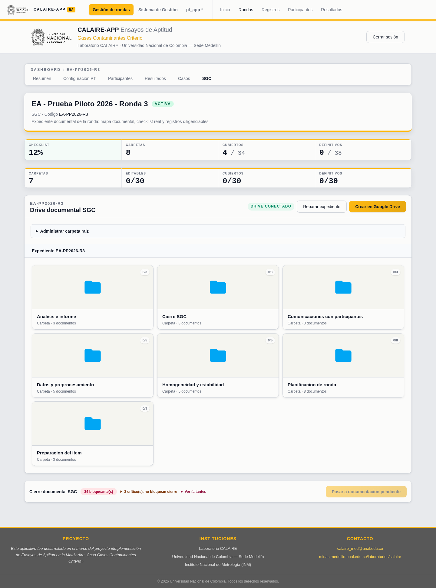

1. **El expediente está desincronizado del catálogo.**

   | | Catálogo | Expediente |
   |---|---|---|
   | Carpetas | 8 | 7 |
   | Documentos | 34–38 | 30 |

   - La pantalla muestra dos filas de indicadores contradictorias, una debajo de la otra, sin explicación.
   - Falta la carpeta `02A_inicio_ronda` (F-PSEA-19), y en Preparación faltan F-PSEA-20 y F-PSEA-21. Pasa lo mismo en la ronda más reciente.
   - Probablemente "Reparar expediente" lo resuelve, pero la interfaz no lo indica.
   - Referencias: `convex/_lib/sgc/catalog.ts:261`, `src/server/sgc/catalog.ts:260`.

2. **F-PSEA-19 y F-PSEA-21 no tienen ruta de acceso.**
   - Las páginas `…/sgc/f-psea-19` y `…/sgc/f-psea-21` existen y cargan.
   - Los botones "Gestionar acta" y "Gestionar instrumentos" solo aparecen al seleccionar ese documento en el expediente (`DriveDocumentalSgc.tsx:435-436`). Como el documento no está en el expediente, solo se llega escribiendo la URL.

3. **Drive aparece conectado, pero la ronda no tiene carpeta.**
   - La insignia dice "DRIVE CONECTADO" y "Administrar carpeta raíz" muestra "Sin folderId registrado".
   - Todos los pendientes de tipo "falta enlace editable" quedan sin forma de resolverse.
   - "Crear en Google Drive" es el botón principal y no explica qué crea.

4. **Los datos de la app no alimentan los documentos.**
   - F-PSEA-01 (Calendario) pide un enlace a un XLSX externo, aunque la app tiene calendario de hitos (`/calendario`, ICS).
   - F-PSEA-03 y F-PSEA-05 piden marcar "Diligenciado" a mano, aunque la app ya tiene fichas enviadas y cupos reclamados.
   - F-PSEA-04 ("Equipos exportados desde F-PSEA-03") pide un enlace y no hay exportación disponible.
   - Resultado: se pide duplicar en Drive información que la app ya tiene.

5. **El instructivo del participante (I-PSEA-02) aparece como "recurso Drive faltante"**, así que no hay nada que publicar al participante.

### 2.4 Fricción 🟠

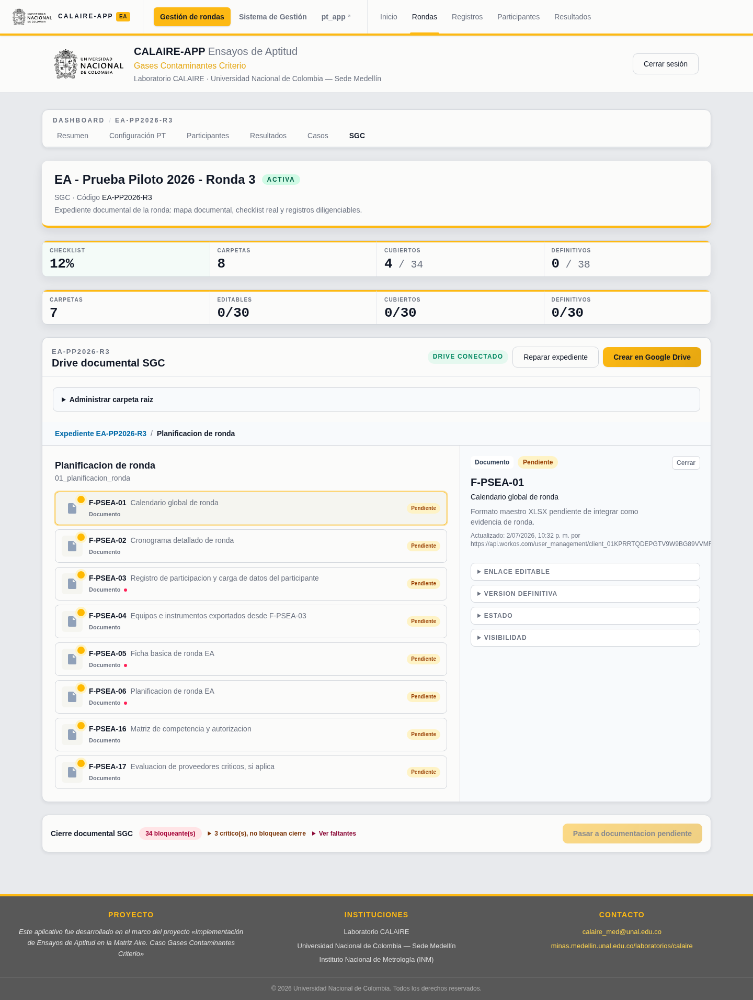

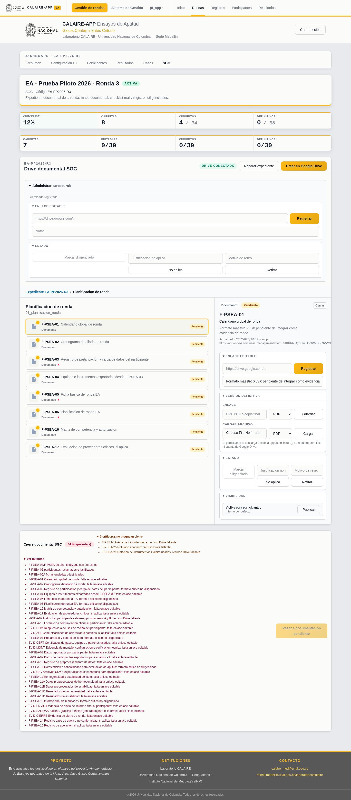

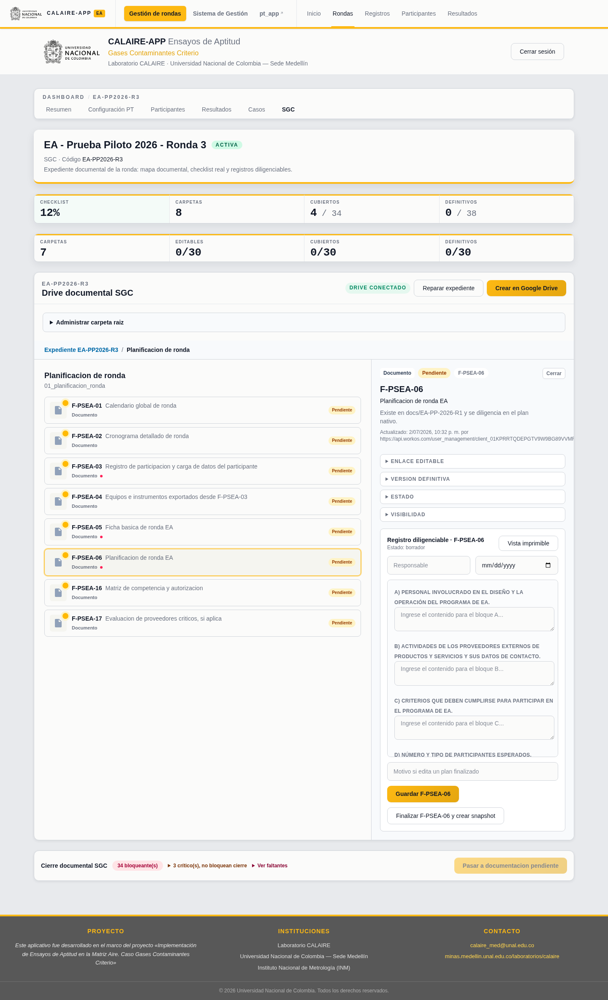

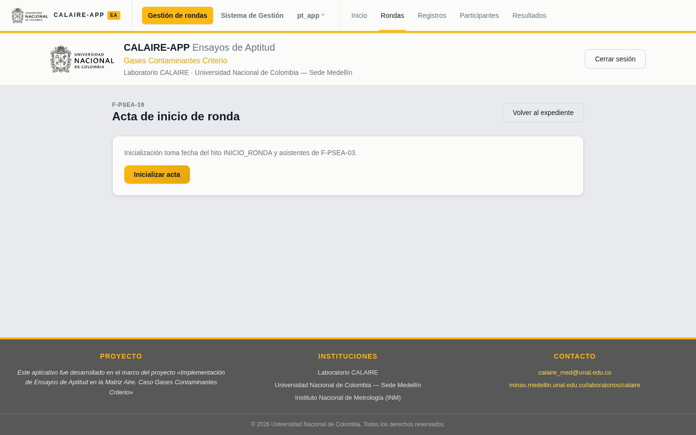

6. **Las acciones están ocultas.** El panel de cada documento esconde lo que hay que hacer en 4 acordeones (Enlace editable, Versión definitiva, Estado, Visibilidad), sin indicar el siguiente paso.
7. **Hay conceptos ambiguos.** "Diligenciado", "Enlace editable", "Versión definitiva", "Publicar", "Cubierto" y "Definitivo" no se explican. Los puntos rojo y amarillo de la lista no tienen leyenda.
8. **F-PSEA-06 se diligencia en un panel lateral estrecho** (~380 px) con scroll interno, 21 bloques de texto (a–u) y fecha en formato `mm/dd/yyyy`. Usa términos técnicos: "Finalizar y crear snapshot".
9. **Se muestran textos internos al usuario:**
   - "Actualizado por `https://api.workos.com/user_management/client_01KP…`" en lugar del nombre de la persona.
   - "Existe en docs/EA-PP-2026-R1…" mostrado en la ronda R3.
   - "Formato maestro XLSX pendiente de integrar".
10. **El acta F-PSEA-19 no guía al usuario.**
    - Solo muestra el botón "Inicializar acta".
    - Si el hito `INICIO_RONDA` no tiene fecha, el error aparece después del clic (`convex/sgc/actaInicio.ts:59`).
    - No muestra un indicador de pasos borrador → DOCX → PDF firmado → publicado.
11. **Las carpetas están en orden alfabético** y no en el orden del proceso. Les faltan tildes: "Planificacion", "Preparacion", "Analisis".
12. **El cierre es confuso.**
    - El botón "Pasar a documentación pendiente" está deshabilitado sin explicación.
    - Bloqueantes y críticos no bloqueantes tienen el mismo peso visual.

### 2.5 Lo que funciona 🟢

- "Ver faltantes" es preciso: una línea por documento con su motivo.
- La estructura de carpetas sigue los procedimientos.
- Los registros nativos (F-PSEA-06 y F-PSEA-13) tienen vista imprimible.
- La app impide publicar documentos internos (F-PSEA-20 y F-PSEA-21) (`convex/sgc/drive.ts:738`).
- Se explica que el participante descarga los documentos desde la app sin necesitar una cuenta de Drive.

### 2.6 Recomendaciones

1. **Sincronizar el expediente automáticamente** al abrirlo, o mostrar un aviso: "Hay N documentos nuevos en el catálogo → Actualizar expediente".
2. **Organizar la vista por etapas del proceso** en lugar de una cuadrícula de carpetas:
   - Cada documento con **una sola acción principal** según su estado (Crear en Drive → Diligenciar → Cargar definitivo → Publicar).
   - Acceso directo a "Gestionar" para F-PSEA-19 y F-PSEA-21.
3. **Generar documentos desde los datos de la app:**
   - F-PSEA-01 y 02 desde los hitos.
   - F-PSEA-03, 04 y 05 desde fichas y registros.
   - Marcarlos como cumplidos automáticamente cuando el dato existe.
4. **Un único indicador de avance por etapa**, con un cierre que explique qué falta, quién lo hace y un enlace directo a cada pendiente.
5. **F-PSEA-19 con indicador de pasos** y validación previa del hito `INICIO_RONDA`, antes de presionar el botón.
6. **Limpiar textos:** tildes, nombre del usuario en vez del identificador de WorkOS, formato de fecha `dd/mm/aaaa` y sin rutas internas.

---

## 3. Diagnóstico UI/UX general

### 3.1 Crítico 🔴: calidad de datos en la captura PT

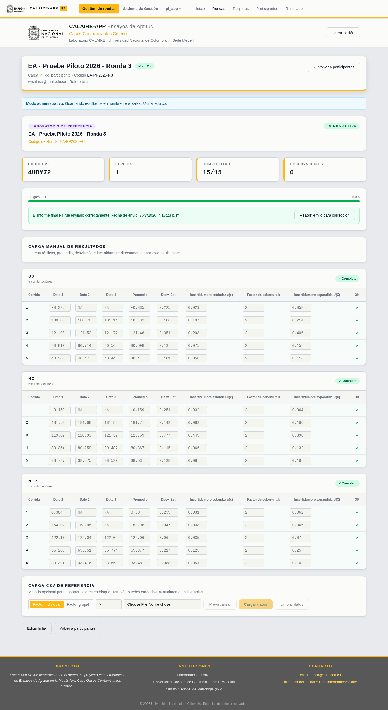

Referencia: `src/app/(protected)/ronda/[codigo]/FormularioRonda.tsx`.

1. **Los inputs truncan los valores.** Dato 1–3, Promedio y Desv. Est. son demasiado angostos: se ve `180.8` en lugar de `180.86…`. No se puede verificar lo que está guardado. La columna "Incertidumbre expandida" tiene espacio sobrante.
2. **`type="number"` (línea ~806):**
   - La rueda del mouse cambia el valor del campo que tiene el foco, y el autoguardado lo registra.
   - Rechaza la coma decimal (`12,5`), que es la usual en Colombia.
   - Usar `type="text" inputMode="decimal"` y normalizar la coma.
3. **Promedio y desviación estándar se escriben a mano** aunque Dato 1–3 ya están. Conviene calcularlos o advertir cuando no coinciden.
4. **Errores solo en tooltip** (`✗` con `title`, línea ~881). No se ven en pantallas táctiles ni con lector de pantalla. El texto "Faltan N celdas" no dice cuáles.
5. **Las celdas de la tabla no tienen `aria-label`.** En todo `src/` hay ~269 `<input>` contra ~104 etiquetas.
6. **La carga CSV queda al final**, debajo de ~45 filas. El nombre de la ronda, el estado "ACTIVA" y "Volver a participantes" aparecen duplicados.

### 3.2 Alto 🟠: navegación y estructura

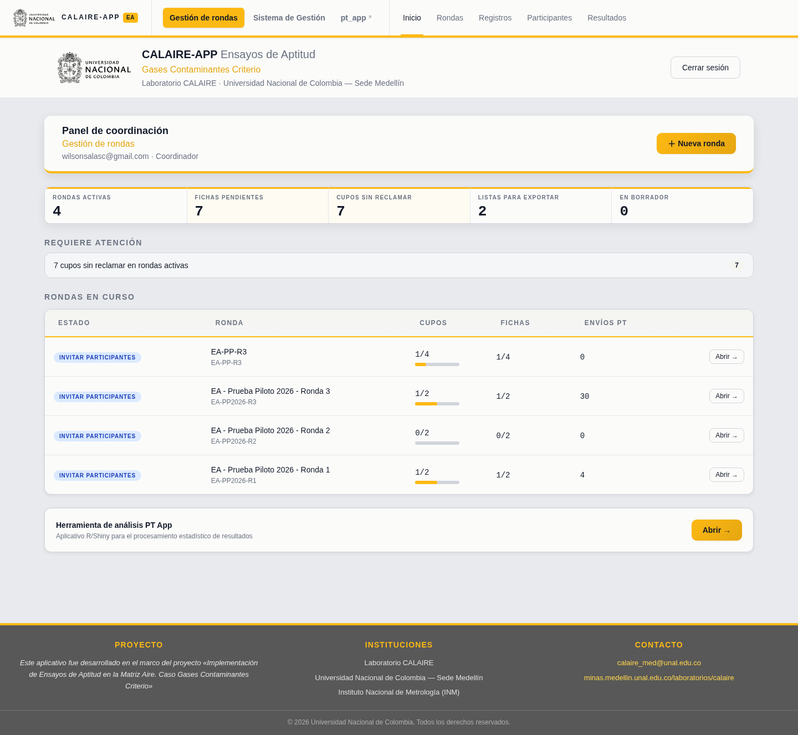

| Móvil: panel | Móvil: participantes de ronda |
|---|---|
| 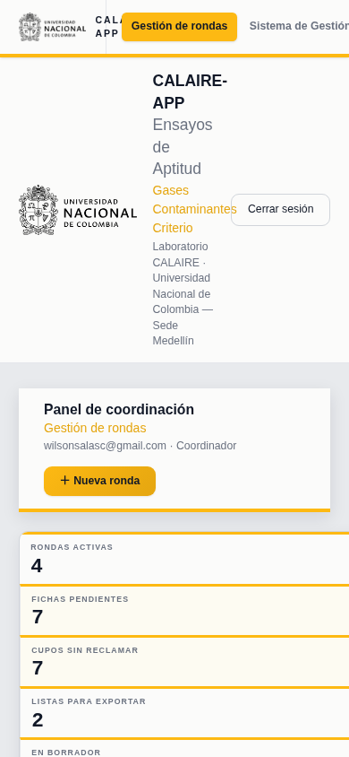 | 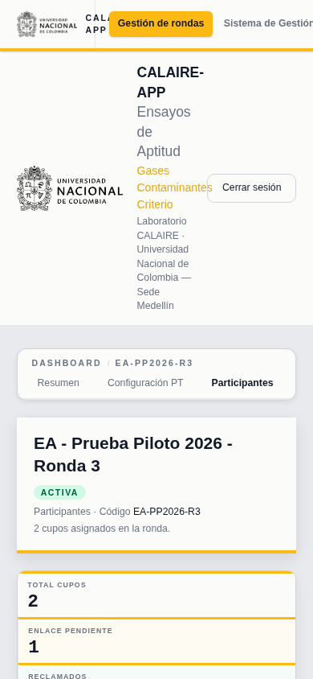 |

7. **Tres cabeceras apiladas** (barra de navegación, franja con el logo y tarjeta de la página), ~310 px antes del contenido. El logo aparece dos veces (`dashboard/SidebarNav.tsx:131-197`). Propuesta: una sola barra con menú de usuario.
8. **No hay navegación móvil.** `MobileNav()` devuelve `null`. A 390 px:
   - Todas las pantallas desbordan horizontalmente.
   - El título se parte palabra por palabra.
   - Las secciones quedan fuera de la pantalla.
9. **El participante no puede cerrar sesión** fuera de `/mi-dashboard`: el botón no está en `ParticipantTopNav`.
10. **"Inicio" siempre aparece activo** para el participante (`ParticipantTopNav.tsx:22`, `aria-current="page"` fijo), incluso en `/calendario`.
11. **El panel del participante muestra el desempeño antes que sus rondas** (`mi-dashboard/page.tsx:413`). Las tareas pendientes deberían ir primero.
12. **El enlace "pt_app"** a shinyapps está al nivel de las áreas principales, con un nombre poco descriptivo.

### 3.3 Alto 🟠: información contradictoria

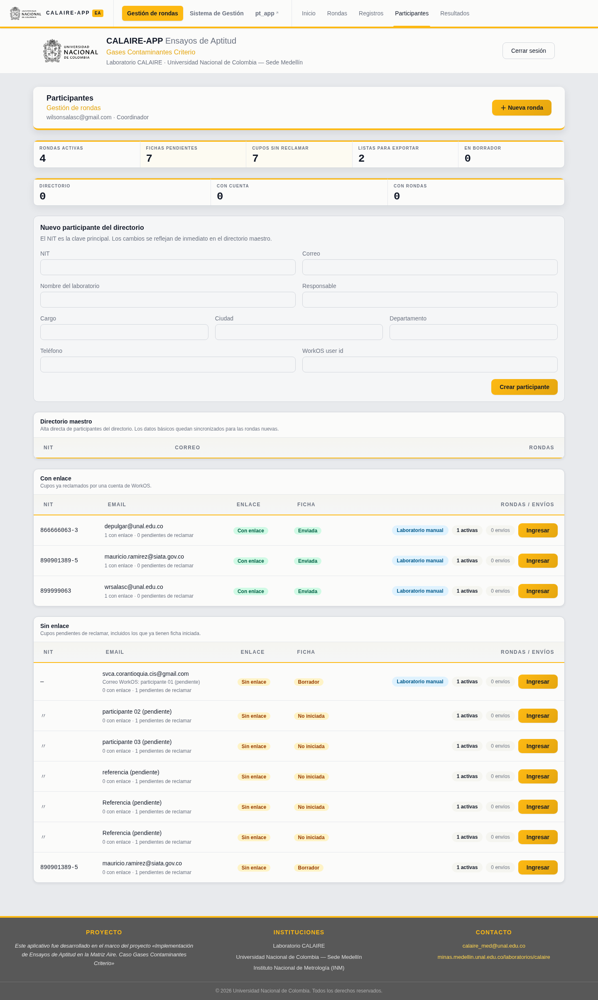

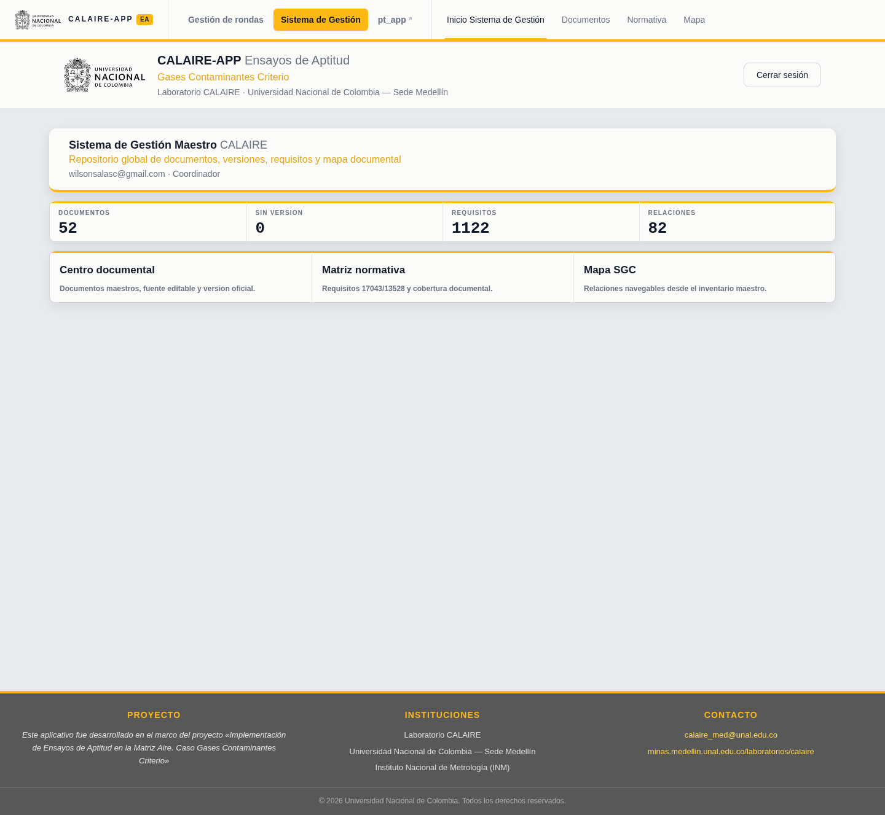

13. **El estado de una ronda varía según la pantalla.** En el panel, las 4 rondas dicen "INVITAR PARTICIPANTES". En el detalle, R3 dice "ACTIVA" y "Lista para exportar", con 30 envíos.
14. **Participantes:**
    - "Directorio maestro" muestra 0 y la tabla está vacía, aunque debajo se listan 10 cupos.
    - El mismo correo (`mauricio.ramirez@siata.gov.co`) aparece a la vez en "Con enlace" y en "Sin enlace".
15. **Avisos y tarjetas que no son enlaces:**
    - "Requiere atención: 7 cupos sin reclamar" no lleva a ninguna parte.
    - Las tarjetas Centro documental, Matriz normativa y Mapa SGC del inicio del SGC parecen botones, pero no son enlaces.

### 3.4 Medio 🟡: jerarquía, consistencia y accesibilidad

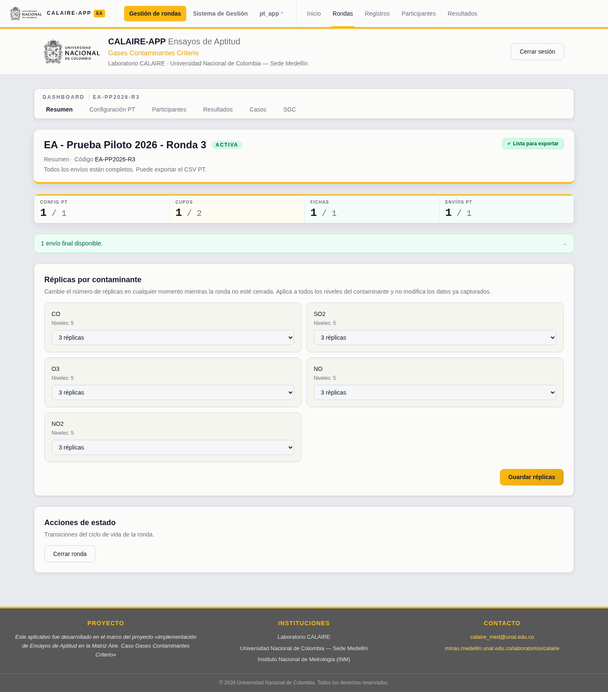

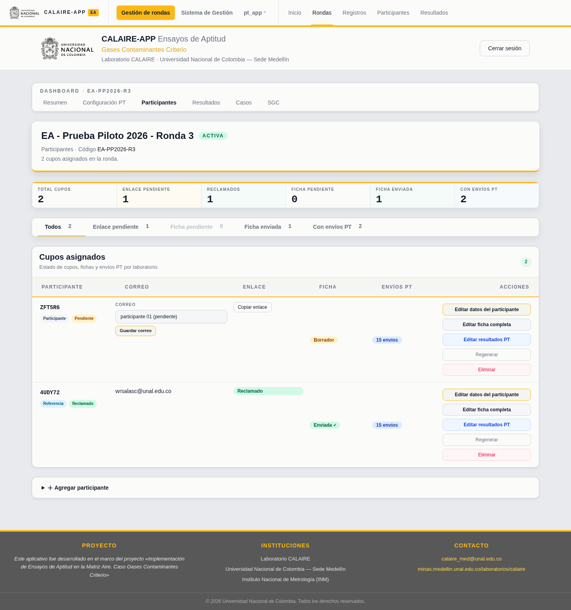

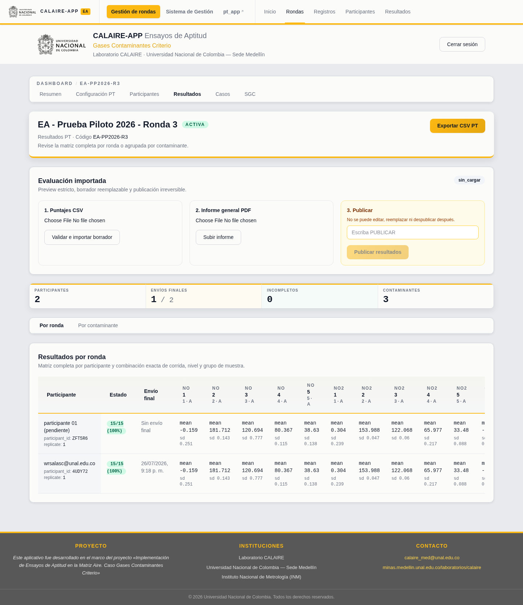

16. **Detalle de ronda:**
    - La pestaña "Resumen" en realidad es la configuración de réplicas.
    - "Cerrar ronda", una acción irreversible, aparece como botón secundario sin ninguna zona de peligro.
17. **Participantes de ronda:**
    - 5 botones apilados por fila, con "Eliminar" junto a los demás.
    - El campo de correo muestra "participante 01 (pendiente)".
18. **Participantes global:**
    - El formulario de alta está arriba y empuja la lista hacia abajo.
    - Pide "WorkOS user id", un dato técnico.
    - Repite los indicadores del panel principal.
    - Usa `〃` en lugar del NIT.
19. **Resultados:**
    - Muestra términos internos o en inglés: `sin_cargar`, "Preview estricto", `mean` / `sd`.
    - La matriz se desplaza hacia los lados sin columna fija para el participante.
20. **Contraste por debajo de WCAG AA** (se exige 4.5:1):

    | Uso | Contraste |
    |---|---|
    | Texto `--pt-primary-dark` sobre el panel (25 usos) | 2.07:1 |
    | Anillo de foco dorado | 1.67:1 |
    | `--success` como texto | 2.77:1 |
    | `--foreground-muted` sobre el fondo | 4.01:1 |

21. **Dos sistemas visuales mezclados:**
    - ~687 usos de colores Tailwind fijos (`slate`, `amber`, `emerald`…) frente a ~1229 usos de tokens.
    - `denied` y `not-found` tienen un estilo propio.
22. **Anchos desalineados:** la cabecera usa `max-w-screen-2xl` y el contenido `max-w-7xl`.
23. **Casi no hay estados de carga.** Solo 3 componentes usan `useTransition` o `useActionState`. La mayoría de los botones no se deshabilitan mientras procesan, lo que invita al doble clic.
24. **`window.confirm` nativo** para acciones irreversibles: `FormularioRonda`, `FormularioReferencia`, `InstrumentosEditor`, `ConfirmSubmitButton`.
25. **Textos en inglés o técnicos:**
    - El selector de archivos nativo dice "Choose File / No file chosen".
    - Se usan emojis como íconos de estado (`rondas/[id]/page.tsx:37`, mapa SGC).

### 3.5 Menor 🟢

- **Ortografía:**
  - Tildes faltantes en `denied/page.tsx` y `not-found.tsx` ("seccion", "sesion", "operacion"), y en "SIN VERSION" y "version oficial".
  - "combinaciónes" con tilde equivocada.
- **Áreas pequeñas:**
  - Scrollbar de 6 px.
  - Botones de ~36 px de alto, por debajo del mínimo táctil de 44 px.
- **El título de la pestaña es siempre "CALAIRE APP"**: falta `metadata` por página.

### 3.6 Fortalezas

- Tokens de diseño centralizados.
- `loading.tsx` y `error.tsx` por sección, más un aviso cuando el backend está fuera de línea.
- Autoguardado por celda en la captura PT, con estado visible.
- Enlaces externos con texto para lectores de pantalla.
- Cifras tabulares (`.numeric`).
- La publicación de resultados exige escribir "PUBLICAR".

---

## 4. Plan sugerido

| Fase | Contenido | Puntos |
|---|---|---|
| **1. Datos y documentación** | Ensanchar los inputs PT, aceptar la coma, sacar los inputs de `type=number`, errores visibles. Sincronizar el expediente con el catálogo, dar acceso a F-PSEA-19 y F-PSEA-21, aclarar el estado de Drive. | 3.1 (1–5), 2.3 (1–3) |
| **2. Flujo documental guiado** | Vista por etapas con una acción principal por documento, autollenado desde los datos de la app, un indicador único de avance y cierre explicado. | 2.6 |
| **3. Navegación** | Una sola cabecera con menú de usuario, navegación móvil, anchos alineados, cerrar sesión para el participante, `aria-current` correcto. | 3.2 |
| **4. Coherencia** | Unificar los estados de ronda y los conteos del directorio; convertir avisos y tarjetas en enlaces. | 3.3 |
| **5. Sistema de diseño** | Botón con estado de carga, diálogo de confirmación propio, avisos emergentes, tokens en lugar de colores Tailwind fijos, contraste AA. | 3.4 |
| **6. Pulido** | Tildes, textos técnicos, `metadata` por página, áreas táctiles. | 3.5 |

---

## 5. Pendiente de verificar

- Crear el expediente en Drive, ejecutar "Reparar expediente" e inicializar F-PSEA-19 y F-PSEA-21. Implican cambiar datos, por lo que deben probarse en una ronda de prueba o en un entorno de desarrollo.
- La vista del participante: documentos publicados, calendario y captura PT, con una cuenta de participante de prueba.
